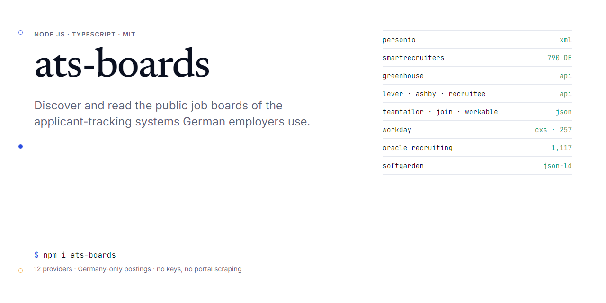

# ats-boards

[](https://www.npmjs.com/package/ats-boards) [](LICENSE) 



Discover and read the **public job boards** of the applicant-tracking systems German employers use — without scraping job portals.

Most companies do not host their own job list. The career page embeds a board on Personio, SmartRecruiters, Greenhouse, Workday, Oracle, softgarden … and those boards expose public, keyless endpoints. This package finds the board link in a career page and reads the postings from it, in one common shape.

| Provider | Discovery pattern | Read from | Verified against |
|---|---|---|---|
| Personio | `{code}.jobs.personio.de`, `jobs.personio.de/{code}` | `/xml` feed | clark |
| SmartRecruiters | `careers.smartrecruiters.com/{Code}` | posting API | BoschGroup (790 DE postings) |
| Greenhouse | `boards.greenhouse.io/{code}`, embed `?for=` | boards API | celonis |
| Lever | `jobs.lever.co/{code}` | postings API | kolibrigames |
| Ashby | `jobs.ashbyhq.com/{code}` | posting API | statista, parloa |
| Recruitee | `{code}.recruitee.com` | offers API | everdrop |
| Teamtailor | `{code}.teamtailor.com` | JSON feed | — |
| JOIN | `join.com/companies/{code}` | public JSON | — |
| Workable | `apply.workable.com/{code}` | widget API | — |
| Workday | `{tenant}.wd{N}.myworkdayjobs.com/{Site}` | CXS JSON (Germany facet) | db.wd3/DBWebsite (257) |
| Oracle Recruiting | `{host}.fa.{region}.oraclecloud.com/…/sites/CX_…` | `recruitingCEJobRequisitions` | Sana Kliniken (1,117) |
| softgarden | `{code}.softgarden.io` | JobPosting JSON-LD on posting pages | visiolife-group |

Only Germany-located postings are returned; the location filter is intentionally conservative (see `germany.ts`).

## Install

```bash
npm i ats-boards
```

Node 20+. No dependencies.

## Use

```ts
import { discoverBoards, readBoard, setUserAgent } from 'ats-boards'

// Identify yourself to the sites you read.
setUserAgent('Mozilla/5.0 (compatible; MyCrawler/1.0; +https://example.com/bot)')

// 1. Find boards in a career page you already fetched.
const html = await (await fetch('https://www.example-gmbh.de/karriere')).text()
const boards = discoverBoards(html)
// → [{ saglayici: 'personio', kod: 'example-gmbh', url: 'https://example-gmbh.jobs.personio.de/' }]

// 2. Read the postings.
for (const b of boards) {
  const result = await readBoard(b.saglayici, b.kod, { isveren: 'Example GmbH', alanAdi: 'example-gmbh.de' })
  if (result.durum === 'tamam') {
    for (const p of result.ilanlar) console.log(p.baslik, p.konumlar[0]?.sehir, p.ilanUrl)
  } else {
    console.warn(result.sebep, result.mesaj) // 'erisim' | 'yetki' | 'kota' | 'bicim'
  }
}
```

`readBoard` returns `{ durum: 'tamam', ilanlar: [] }` for a board that no longer exists (HTTP 404) — that is "no postings", not an error. Rate limits come back as `sebep: 'kota'`.

### Posting shape

```ts
type Posting = {
  kaynak: string          // provider id
  kaynakKimligi: string   // "{boardCode}:{jobId}", stable per provider
  baslik: string
  isveren?: string
  konumlar: { sehir?: string; ulke: string }[]
  metin?: string          // full text, HTML stripped (when the provider returns it)
  calismaSuresi: 'tam_zamanli' | 'yari_zamanli' | 'vardiyali' | 'bilinmiyor'
  yayinTarihi?: string    // YYYY-MM-DD
  ilanUrl?: string
}
```

Field names are Turkish (the package grew inside a Turkish product); the exported function names are English.

## Notes on behaviour

- Every request has a 15 s timeout and a descriptive user agent.
- List endpoints are paged up to 10 pages (20 for Workday). Workday and Oracle need one extra request per posting for the full text; those are read in a rotating window of 40 per call so a large board is covered over a day rather than in one burst.
- Only what the provider returns is used. Nothing is inferred; if a board does not give a text, `metin` stays empty.
- These are the same endpoints the providers' own career pages call. Check each provider's terms for your use case; this package does not bypass any authentication.

## Development

```bash
npm test            # discovery tests (offline)
npm run build       # tsc → dist/
```

Adding a provider: a discovery rule in `src/discover.ts`, a reader in `src/readers.ts` (verify it against a real employer and note which one), and a test line in `tests/discover.test.ts`.

## Why this exists

Built for [Kelyvaro](https://kelyvaro.com), a tool that helps job seekers from Turkey apply to German employers directly. The matching and application parts stay in the product; the board readers are generic and useful to anyone collecting German job postings, so they live here.

MIT © Murat Sert
